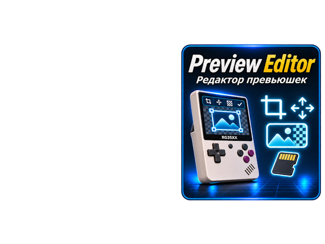

# Preview Editor 1.1.0

Русскоязычный редактор PNG-превью для **оригинальной Anbernic RG35XX с GarlicOS 1.4.9**. Позволяет открыть изображение с TF1 или TF2, подготовить обложку 640 × 480, проверить её в оформлении GarlicOS и сохранить результат. В версии 1.1.0 добавлено создание копии под именем ROM в корневой папке `Img_Gen` выбранной карты.



[Скачать релиз 1.1.0](https://github.com/alex-13021991/Anbernic-RG35XX/releases/tag/preview-editor-v1.1.0) · [История изменений](CHANGELOG.md) · [Установка и краткое управление](Установка.txt) · [Проверки релиза](docs/VALIDATION-1.1.0.md)

## Возможности

- Просмотр папок и открытие PNG на обеих SD-картах.
- Перемещение, масштабирование, обрезка и девять вариантов выравнивания изображения.
- Настройка отступа и высоты верхней и нижней панелей темы.
- Предпросмотр обложки в оформлении GarlicOS.
- История правок с отменой и повтором.
- Сохранение PNG 640 × 480 с прозрачностью и проверкой результата.
- Резервная копия исходного файла перед первой заменой и восстановление оригинала.
- **«Переименовать под ROM»**: отдельная копия без суффикса скриншота в `Img_Gen` на TF1 или TF2.

## Совместимость и установка

Целевая платформа — оригинальная RG35XX, GarlicOS 1.4.9, экран 640 × 480. Сборка ARM EABI5, Cortex-A9, softfp, загрузчик `/lib/ld-uClibc.so.0`, SDL 1.2. Совместимость с другими моделями RG35XX и другими ОС в этом релизе не проверялась.

1. Скачайте `PreviewEditor-1.1.0-GarlicOS-1.4.9.zip` из релиза.
2. Распакуйте его и скопируйте папку `Roms` в корень раздела с играми на TF1 или TF2, объединив каталоги.
3. Убедитесь, что появился файл `Roms/APPS/Preview Editor.sh` и рядом папка `Roms/APPS/PreviewEditor`.
4. В GarlicOS откройте **APPS → Preview Editor**.

Картинка пункта меню устанавливается в `Roms/APPS/Imgs/Preview Editor.png`. Архив также содержит шрифт, адаптер кнопок, libpng и лицензии. Запускной скрипт задаёт пути к библиотекам приложения.

При обновлении с 1.0.0 скопируйте новую папку `Roms` поверх старой с заменой файлов. Установочный ZIP не содержит `preview.cfg`, поэтому сохранённые настройки сохраняются. Изображения и папки `.preview-originals` при таком обновлении не заменяются файлами установщика.

## Выбор карты и файла

При запуске выберите TF1 или TF2. Место установки программы не определяет карту результата: значение имеет карта, выбранная при открытии PNG.

| Кнопка | В списке файлов |
| --- | --- |
| ↑ / ↓ | Выбор карты, папки или PNG |
| A | Открыть карту, папку или файл |
| L / R | Перейти на девять строк назад или вперёд |
| B | Подняться на уровень; в выборе карт — выйти |
| X | Восстановить выбранный PNG из резервной копии |

Список показывает папки и файлы с расширением `.png` без учёта регистра, включая `.PNG`. Скрытые имена и символические ссылки не отображаются. Превью игр обычно находятся в `Roms/<система>/Imgs`, но открыть PNG можно в другом доступном каталоге карты.

По умолчанию корни карт: TF1 — `/mnt/mmc`, TF2 — `/mnt/SDCARD`.

## Холст, прозрачность и открытие изображения

Экспортируемый холст имеет размер **640 × 480**. В редакторе он показан в масштабе 80% — 512 × 384, чтобы одновременно видеть края и подсказки. В предпросмотре GarlicOS используется весь экран.

Редактор выделяет прямоугольник вокруг всех пикселей с альфой от 1 до 255. Учитываются полупрозрачные тени и отдельные непрозрачные фрагменты. Полностью прозрачный PNG не открывается для правки: программа показывает сообщение о пустом изображении.

Для PNG размером 640 × 480 исходное положение видимых пикселей сохраняется. Для другого размера выделенный объект центрируется и при необходимости уменьшается до размеров холста. Маленький объект автоматически не увеличивается.

Предел исходника — **8 388 608 пикселей**, не более **8192 px по любой стороне**. Чтение поддерживаемых libpng разновидностей PNG приводит изображение к RGBA в памяти, в том числе для индексированных PNG с прозрачностью.

Шахматный фон, направляющие, выделение, меню и надписи не попадают в сохраняемую обложку. За границами холста объект можно продолжать перемещать; при экспорте записывается только видимая часть.

## Управление на холсте

| Кнопка | Действие |
| --- | --- |
| Крестовина | Переместить объект на выбранный шаг |
| L / R | Уменьшить / увеличить масштаб на 5 процентных пунктов |
| A / MENU | Открыть инструменты |
| X | Отменить правку |
| Y | Повторить отменённую правку |
| B | Вернуться к файлам; при несохранённых изменениях — запрос закрытия |

Шаг перемещения переключается между **1 px** и **8 px**. Масштаб ограничен диапазоном **1–400%**. Масштабирование выполняется по ближайшему пикселю; изменение масштаба сохраняет центр объекта с учётом округления.

В памяти хранится до **128 состояний** размещения, включая текущее. В историю входят перемещение, масштаб, применённая обрезка и выравнивание. Новая правка после отмены начинает новую ветку истории. Повторное масштабирование не пересчитывает уже уменьшенную копию: рендер использует исходный растр.

## Инструменты

Инструменты выбираются кнопками ↑ / ↓, A запускает выбранный пункт, B возвращает к холсту.

### Автоматическое выравнивание по краю

Доступны девять позиций: слева, по центру и справа для верхней, центральной и нижней строк. Крестовина выбирает позицию, A применяет её, B отменяет предварительное размещение.

Привязка учитывает видимые пиксели после текущей обрезки и масштабирования:

- Слева и справа оставляется настроенный отступ от края холста.
- Сверху оставляется верхняя панель темы и отступ.
- Снизу оставляется нижняя панель темы и отступ.
- Центральная строка центрируется между верхней и нижней панелями.

Крупный объект сохраняет масштаб и может выйти за противоположную границу. Применённое выравнивание записывается как одна правка, после которой доступны ручное перемещение и отмена.

### Обрезка

↑ / ↓ выбирают левый, верхний, правый или нижний край. → срезает 1 пиксель исходника, ← возвращает 1 пиксель. L / R возвращают или срезают 8 пикселей. A применяет обрезку, B отменяет её предварительный результат.

Обрезка ограничена размерами исходного растра и оставляет хотя бы один пиксель по каждой стороне. Возвращать можно только пиксели, существующие в исходнике. Применённая обрезка входит в историю.

### Предпросмотр GarlicOS

Программа показывает обложку на полноэкранном фоне темы и добавляет имитацию списка соседних PNG. Из `CFW/skin` на TF1 читаются фон, игровой оверлей, значки кнопок и батареи, цвета, выравнивание текста и поля. Шрифты выбираются из `CFW/font` с учётом языка темы. Системные файлы используются для чтения.

Если нужных ресурсов нет, применяются FreeSans, рисованные значки и однотонный фон. Строки списка статичны, индикатор батареи демонстрационный. Это предпросмотр внутри редактора, а не запуск списка ROM в GarlicOS. A, B или Y возвращают в инструменты.

### Шаг перемещения

A или ← / → переключают шаг **1 / 8 px**. Шаг применяется к перемещению крестовиной на холсте. После нового запуска он снова равен 1 px.

### Отступ и панели темы

Три настройки: отступ от края, верхняя строка, нижняя строка. ↑ / ↓ выбирают строку, ← / → меняют значение на 1 px, L / R — на 8 px. Значения находятся в пределах 0–120 px; для панелей доступен режим «Авто».

X возвращает выбранную строку к исходному значению: отступ 16 px, панели «Авто». A сохраняет настройки в `preview.cfg` рядом с программой, B отменяет изменения этого экрана. Настройки используются при следующем выравнивании и отображаются направляющими.

В режиме «Авто» базовые резервы — **43 px сверху и 49 px снизу**. Они соответствуют оценке занятой части экрана в исходной теме: видимая верхняя графика y=14…42, нижняя y=431…459. При отступе 16 px верхняя привязка начинается с y=59, нижняя заканчивается на y=414; горизонтальные пределы x=16 и x=623.

Редактор дополнительно анализирует `CFW/skin/game-overlay.png` на TF1. Непрерывная полоса с внешнего края, занимающая не менее двух третей ширины при альфе от 16, может увеличить резерв. Проверяются первые 120 строк с каждого края; сплошная тонировка всего экрана игнорируется.

Если в `CFW/skin/settings.json` явно заданы целые `top-panel-height` и `bottom-panel-height` в пределах 0–120, используются эти значения. Это дополнительные подсказки Preview Editor; наличие таких полей в каждой теме не предполагается. Ручные значения имеют приоритет. После смены темы перезапустите редактор.

### Сохранить PNG

После подтверждения текущий холст записывается **под прежним именем и по прежнему пути** как RGBA PNG 640 × 480. Перед первой заменой создаётся резервная копия исходника. Полностью пустой холст не сохраняется.

После успешной записи текущее размещение считается сохранённым, редактирование можно продолжить. Повторные сохранения используют ту же исходную резервную копию.

### Восстановить оригинал

Оригинал берётся из скрытой папки `.preview-originals` рядом с файлом. После подтверждения текущий PNG заменяется точной копией исходных байтов. Резервная копия остаётся доступной.

Восстановление доступно из инструментов и кнопкой X в списке файлов. Через список можно восстановить PNG, который уже не декодируется. После восстановления из инструментов документ закрывается и программа возвращается к списку файлов.

### Переименовать под ROM — новое в 1.1.0

Команда **создаёт отдельную копию** изображения с именем ROM. Открытый исходник сохраняет имя, путь и содержимое.

1. Откройте скриншот или превью на нужной карте.
2. При необходимости отредактируйте изображение.
3. Откройте инструменты и выберите **«Переименовать под ROM»**.
4. Копия появится в папке **`Img_Gen` в корне карты открытого файла**. Отсутствующая папка создаётся автоматически, без отдельного запроса.
5. Если файл с таким именем уже есть, подтвердите замену копии или отмените действие.

| Открытый файл | Результат |
| --- | --- |
| `Jazz Jackrabbit 2_002.png` на TF1 | `TF1:/Img_Gen/Jazz Jackrabbit 2.png` |
| `Batman Returns (U) [!]-261121-130355.png` на TF2 | `TF2:/Img_Gen/Batman Returns (U) [!].png` |
| `GarlicOS_015.PNG` на TF1 | `TF1:/Img_Gen/GarlicOS.PNG` |
| `Game.png` на TF2 | `TF2:/Img_Gen/Game.png` |

Удаляется **один конечный суффикс непосредственно перед расширением**:

- `_NNN` — подчёркивание и ровно три цифры.
- `-YYMMDD-HHMMSS` — две группы по шесть цифр через дефис, с начальным дефисом.

Название ROM, пробелы, скобки, региональные обозначения и расширение сохраняются. Регистр расширения не меняется. Дата и время определяются по форме суффикса, без проверки календарной корректности. `_12`, `_1234` и суффиксы с буквами не обрезаются. Если подходящего суффикса нет, имя остаётся прежним. Команда не ищет ROM на карте и не сверяет название с базой игр.

**Содержимое копии зависит от состояния редактора:**

- Без несохранённых правок копируются точные байты открытого PNG: сохраняются исходные размеры, кодирование и метаданные.
- При наличии несохранённых правок экспортируется текущий холст RGBA 640 × 480. Полностью пустой холст экспортировать нельзя.
- После копирования открытым остаётся исходный документ. История, путь и отметка несохранённых правок не сбрасываются.

Таким образом, создание копии не равнозначно пункту «Сохранить PNG». Если после экспорта правки остались несохранёнными и нажать B на холсте, редактор по-прежнему предложит подтвердить закрытие.

`Img_Gen` служит папкой готовых файлов. Команда не переносит их автоматически в `Roms/<система>/Imgs`: при необходимости пользователь переносит готовое превью сам.

При совпадении имени замена затрагивает только файл в `Img_Gen`. Для таких копий отдельная папка `.preview-originals` не создаётся. Сам открытый исходник этой командой заменить нельзя, в том числе когда он уже находится в `Img_Gen` под именем ROM. Папка или ссылка с именем файла назначения вызывает сообщение об ошибке и не заменяется.

## Проверка записи и резервные копии

Перед сохранением или экспортом редактор сверяет SHA-256 исходного PNG с версией, открытой в памяти. Если файл был изменён на карте, нужно открыть его заново.

Новый PNG сначала записывается во временный файл в каталоге назначения и сбрасывается через `fsync`. Для экспортированного холста программа заново декодирует результат и сравнивает размеры и пиксели; при копировании исходника проверяются байты и декодирование PNG. После проверки временный файл публикуется через `rename`, затем синхронизируется каталог. Операции редактора в одной папке сериализуются через `flock`.

При обычном сохранении исходник отдельно копируется в `.preview-originals` с проверкой байтов и синхронизацией до замены основного PNG. Восстановление также публикует проверенную временную копию. При нехватке места, ошибке доступа, повреждённой резервной копии или ошибке записи программа выводит сообщение.

## Сборка из исходников

Нужны Linux / WSL Ubuntu 24.04, Python 3 и **Miyoo ARM GCC SDK 7.3.0** с заголовками и библиотеками SDL 1.2, SDL_ttf и libpng 1.6. Готовый SDK и инструкции: [Toolchains](https://github.com/alex-13021991/Anbernic-RG35XX/tree/main/Toolchains); профиль реальной приставки: [RG35XX-Development](https://github.com/alex-13021991/RG35XX-Development).

Из каталога проекта:

```sh
SDK="$HOME/rg35xx-sdk/miyoo-gcc-7.3.0"
sh build.sh "$SDK"
python3 package.py dist
```

Путь к SDK можно заменить на свой. `build.sh` использует Cortex-A9, ARM EABI5 softfp, включает `-Wall -Wextra -Werror` и создаёт `build/preview-editor`. `package.py` формирует:

| Файл | Содержимое |
| --- | --- |
| `PreviewEditor-1.1.0-GarlicOS-1.4.9.zip` | Установка в `Roms/APPS`, картинка приложения, руководство и лицензии |
| `PreviewEditor-1.1.0-source.zip` | Исходники, тесты, документация, ресурсы и сценарии сборки |
| `SHA256SUMS.txt` | SHA-256 обоих ZIP |

SDK в архив исходников не включён; зависимости SDK устанавливаются отдельно. Вложенные библиотеки и ресурсы сопровождаются лицензиями из `licenses` и `vendor`.

## Автоматические проверки

Для запуска ARM-кода в Linux нужен `qemu-arm` или `qemu-arm-static`:

```sh
SDK="$HOME/rg35xx-sdk/miyoo-gcc-7.3.0"
PREVIEW_TESTS=1 sh build.sh "$SDK"
python3 package.py dist
python3 tests/run.py dist/PreviewEditor-1.1.0-GarlicOS-1.4.9.zip \
  --sdk "$SDK" --qemu /usr/bin/qemu-arm \
  --frame /tmp/preview-menu.bmp --tools-frame /tmp/preview-tools.bmp
(cd dist && sha256sum -c SHA256SUMS.txt)
```

Тест извлекает именно релизный ELF из установочного ZIP и передаёт события кнопок через SDL. Временные TF1/TF2 не затрагивают реальные карты. Параметры `PREVIEW_TF1` и `PREVIEW_TF2` задают корни карт при самостоятельном запуске с эмулятором.

Проверяются геометрия, 108 комбинаций привязки, обрезка, масштаб, отмена/повтор, сохранение и восстановление, конфликт версий файла, ошибка короткой записи, настройки темы и новый экспорт под именем ROM. Для новой функции проверены все имена из предоставленного списка скриншотов, TF1/TF2, автоматическое создание папки, регистр расширения, точное копирование, пиксели изменённого холста, отмена и подтверждение замены, ошибки назначения и неизменность исходников.

Подробности и границы проверки: [VALIDATION-1.1.0.md](docs/VALIDATION-1.1.0.md).
