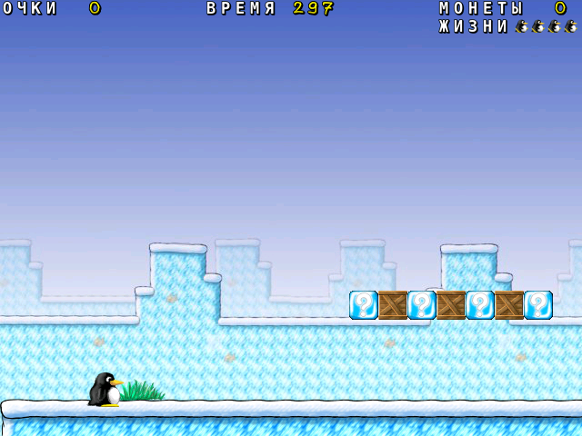

# SuperTux для RG35XX — 0.2.1

Порт SuperTux Milestone 1 из ветки andrigamerita для **оригинальной Anbernic RG35XX с GarlicOS 1.4.9**. Родное разрешение **640×480**, звук, управление кнопками приставки и русский текст. Логотип, фоны, персонажи и игровые изображения сохранены.

**0.2.1 исправляет выход сразу после запуска из PORTS:** меню GarlicOS передаёт приложению 32-битный framebuffer, тогда как первоначальный ADB-тест шёл в RGB565. Теперь поддерживаются оба формата. Исправленная установленная версия проверена владельцем через PORTS.

[Скачать релиз](https://github.com/alex-13021991/Anbernic-RG35XX/releases/tag/supertux-rg35xx-v0.2.1) · [Установка](docs/INSTALL-RU.txt) · [Сборка](docs/BUILD-RU.md) · [Исходная база и патчи](docs/SOURCES-RU.md) · [Русификация](docs/LOCALIZATION-RU.md) · [Проверки](docs/TESTING-RU.md)

## Установка

Распакуйте **SuperTux_RG35XX_v0.2.1_RU.zip** в корень карты с играми с объединением папки Roms. Запуск: **PORTS → SuperTux**. Данные игры включены.

Английский порт выпускается отдельно: SuperTux_RG35XX_v0.1.1_EN.zip. Поверх него можно установить отдельный архив русификатора. При установке полного русского архива дополнение не нужно.

| Кнопка | Действие |
| --- | --- |
| Крестовина | Движение и меню; вниз — пригнуться |
| A | Прыжок; подтверждение; вход в уровень с карты |
| B | Бег / стрельба / действие; возврат в меню |
| START | Пауза в уровне; подтверждение в открытом меню |
| SELECT / MENU | Игровое меню и возврат |
| VOL+ / VOL− | Системная громкость |

Бег и стрельба в SuperTux используют одно действие. X/Y и плечевые кнопки не назначены. Редактор уровней скрыт: он требует мышь.

Штатный выход: MENU → Покинуть уровень; на карте MENU → В главное меню; затем Выход. Слоты и настройки: Roms/PORTS/SuperTux/Saves/.supertux/. При обновлении сохраняйте Saves. Журнал запуска: SuperTux/Logs/run.log.

## Три отдельных слоя

1. **Исходная база**: sources/upstream/ — неизменённый снимок andrigamerita. Рядом сохранены полный снимок dmitrysmagin и исторические полноразмерные ресурсы.
2. **Порт RG35XX**: patches/rg35xx/0001-rg35xx-platform.patch — сборка Cortex-A9, framebuffer/evdev и адаптация запуска.
3. **Русификация поверх порта**: patches/russian/0001-russian-text.patch, отдельные шрифты и исходник их генератора.

Скрипты восстанавливают оба варианта без скачивания исходников игры. Понадобятся Miyoo GCC 7.3.0 и sysroot GarlicOS:

    bash scripts/build.sh en
    bash scripts/build.sh ru
    bash scripts/test.sh
    python3 scripts/package.py

Результаты: .work/en/source/supertux и .work/ru/source/supertux; архивы — dist/. Исходная база при сборке не меняется. Входные файлы проверяются по SOURCE-SHA256SUMS.

## Проверки и лицензии

Владелец подтвердил игру, кнопки, русский текст и загрузку английского слота на приставке. Исправление запуска из PORTS проверено отдельно. Пройдены восстановление из слоёв, пересборка, ABI, тест UTF-8 и сверка ресурсов. Кадры ниже сделаны в QEMU; ограничения проверки приведены в протоколе.

Движок — **GPL-2.0-or-later**, см. [COPYING](COPYING) и оригинальный AUTHORS. Для DejaVu сохранена отдельная лицензия. [История изменений](docs/CHANGELOG-RU.md).

